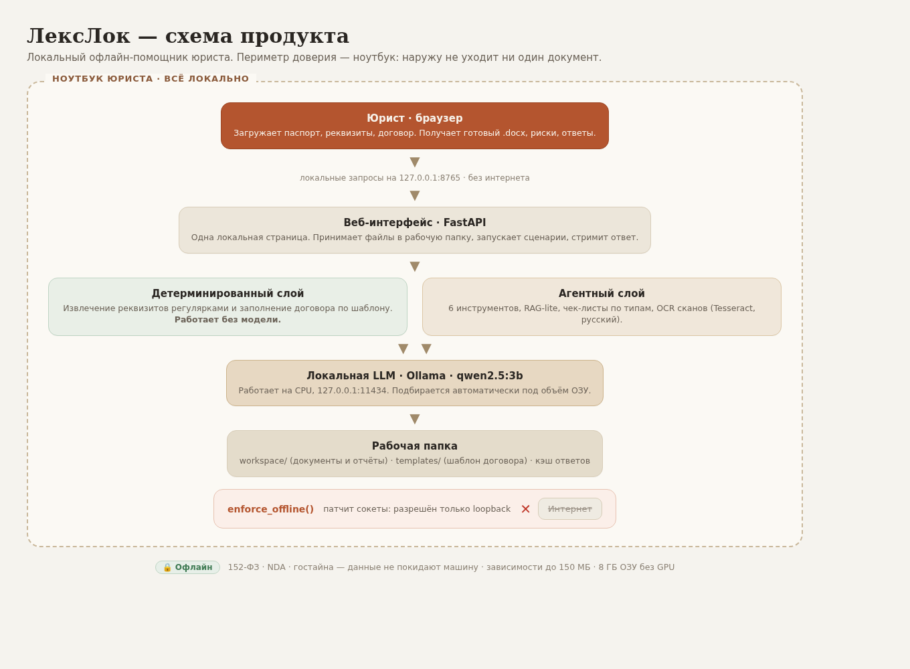

# ЛексЛок — офлайн-инструмент юриста на базе локальной LLM

[](docs/assets/lexlock-demo.mp4)

**▶ Видеопрезентация (20 секунд)** — нажмите на кадр, чтобы посмотреть.

**ЛексЛок** — инструмент для юриста на базе локальной языковой модели (LLM). Модель и все
вычисления работают на самой машине, документы никуда не отправляются. Интернет нужен
только один раз — при установке, чтобы скачать модель. Дальше можно выключить сеть:
заполнение договоров, распознавание сканов и ответы по документам продолжат работать.

Демо для акселератора 2026. Работает на обычном ноутбуке: 8 ГБ ОЗУ, без GPU.


## Зачем это нужно

Юридические документы часто нельзя отдавать во внешние сервисы:

- **152-ФЗ «О персональных данных»** — паспортные данные, ИНН, адреса.
- **NDA и коммерческая тайна** — договоры, реквизиты, суммы.
- **Политика безопасности и GDPR** — запрет на передачу данных третьим лицам.
- **Гостайна и служебная тайна** — работа вообще без внешних сервисов.

Облачные ИИ-ассистенты отправляют текст документов на чужие серверы — для юриста это
неприемлемо. ЛексЛок держит документы и модель рядом с пользователем: в строгом режиме
`LEXLOCK_OFFLINE=1` любые сетевые соединения вне `127.0.0.1` блокируются принудительно.

## Что умеет

ЛексЛок делает упор на задачи, где результат точный и воспроизводимый: извлечение
реквизитов, заполнение шаблонов, чек-листы, классификация и распознавание документов.
Модель помогает там, где сильна, — очищает распознанный текст и дозаполняет отдельные
поля.

1. **Заполнение договора** — извлекает реквизиты (23 поля) из документов и заполняет
   `templates/dogovor_template.docx`. Без модели, на регулярках.
2. **Распознать и разобрать документ (OCR)** — Tesseract распознаёт скан или фото, модель
   очищает артефакты распознавания, затем извлекается «паспорт» документа.
3. **Паспорт документа** — тип (договор, паспорт, реквизиты, доверенность, иск, претензия,
   акт, счёт), стороны, дата, номер, сумма, предмет. Детерминированно.
4. **Чек-лист договора** — проверка по обязательным условиям 6 типов с процентом готовности.
5. **Проверка явных рисков** — поиск опасных условий (автопролонгация, односторонний отказ,
   неустойка, штраф, подсудность) по ключевым маркерам, без модели.
6. **Вопрос по документу** — ответ строго цитатой из текста, без свободных рассуждений.
7. **Диалог с агентом** — модель сама решает, какой из инструментов применить.

Детерминированные сценарии (реквизиты, заполнение, чек-лист, паспорт, риски) работают
в полном объёме без модели. Модель нужна только для OCR-очистки и дозаполнения свободных
текстовых полей; при её отсутствии эти части честно деградируют.

## Как устроено



Браузер открывает локальную страницу на `127.0.0.1:8765`. FastAPI принимает файлы в
рабочую папку. Детерминированная часть извлекает реквизиты регулярками и заполняет
шаблон; LLM-часть идёт в Ollama на `127.0.0.1:11434`. Агентный чат сам выбирает
инструмент. Наружу не уходит ни один запрос — это и есть продукт.

## Требования

| Ресурс | Минимум |
|---|---|
| ОЗУ | 8 ГБ |
| Свободное место | 6 ГБ (модель ~1–2 ГБ + окружение) |
| CPU | 4 ядра, GPU не нужен |
| Python | 3.12 (ставится автоматически вместе с `uv`) |
| Ollama | ставится автоматически скриптом установки |

## Установка

Основной способ — скрипт-установщик: он сам скачивает свежий код из ветки `main`, ставит
всё необходимое, добавляет «ЛексЛок» в меню приложений и открывает браузер.

### Linux

Скачайте [`bootstrap.sh`](https://raw.githubusercontent.com/workihi53-max/lexlock/main/bootstrap.sh),
разрешите запуск (правый клик → «Свойства» → «Разрешить выполнение файла») и откройте
двойным кликом. Либо одной командой:

```bash
curl -fsSL https://raw.githubusercontent.com/workihi53-max/lexlock/main/bootstrap.sh | bash
```

Скрипт скачает проект в `~/lexlock`, поставит окружение, Ollama и модель, создаст ярлык
«ЛексЛок» в меню приложений и сам откроет браузер.

### Windows

Скачайте архив репозитория (Code → Download ZIP), распакуйте и запустите
`packaging\windows\install.ps1` (правый клик → «Выполнить с PowerShell»):

```powershell
powershell -ExecutionPolicy Bypass -File packaging\windows\install.ps1
```

Скрипт скачает свежий код из `main`, поставит `uv`, Ollama и модель, и создаст ярлык
«ЛексЛок» в меню «Пуск».

### macOS

Готовый `LexLock-<версия>.dmg` — в Releases: открыть, перетащить «ЛексЛок» в «Программы»,
запустить. Дальше приложение само скачает компоненты и откроет браузер.

---

Первый запуск на любой системе скачивает Ollama и модель (~2 ГБ), дальше всё работает
офлайн. Установщики подтягивают свежий код из `main`, поэтому достаточно скачать их один
раз — обновления приходят автоматически.

## Как доказать, что приложение офлайн

1. `./run.sh` — по умолчанию `LEXLOCK_OFFLINE=1`.
2. Отключите сеть (Wi-Fi / кабель) — приложение продолжает работать.
3. Любое соединение, кроме `127.0.0.1`, вернёт ошибку.

Для отладки без жёсткого офлайн-режима: `./run.sh --no-offline`.

## Переменные окружения

| Переменная | По умолчанию | Назначение |
|---|---|---|
| `LEXLOCK_MODEL` | подбирается по ОЗУ | модель Ollama |
| `LEXLOCK_OLLAMA_URL` | `http://127.0.0.1:11434` | адрес Ollama |
| `LEXLOCK_WORKSPACE` | `<проект>/workspace` | папка с документами |
| `LEXLOCK_PORT` | `8765` | порт веб-приложения |
| `LEXLOCK_OFFLINE` | `1` | жёсткий офлайн (блок не-loopback) |
| `LEXLOCK_CACHE` | `1` | кэш ответов LLM (`0` — отключить) |
| `LEXLOCK_LLM_EXTRACT` | `1` в `run.sh` | дозаполнение реквизитов моделью |

## Ограничения

- **Первый запуск требует интернет** — скачиваются Ollama и модель. Дальше всё работает офлайн.
- Модель работает на CPU, поэтому распознавание сканов занимает десятки секунд.
- **Это инструмент-помощник на базе LLM, а не замена юристу.** Модель может ошибаться,
  поэтому ЛексЛок делает упор на извлечение фактов и проверку по явным условиям —
  финальное решение остаётся за специалистом.
- Тестовые документы в `samples/` содержат вымышленные данные.

## Для разработчиков

```bash
uv venv --python 3.12 .venv
uv pip install --python .venv/bin/python -e ".[dev]"
.venv/bin/python -m pytest tests -q     # тесты не требуют Ollama
./run.sh
```

Архитектурный контракт интерфейсов — `SPEC.md`, карта модулей и правила — `AGENTS.md`.
