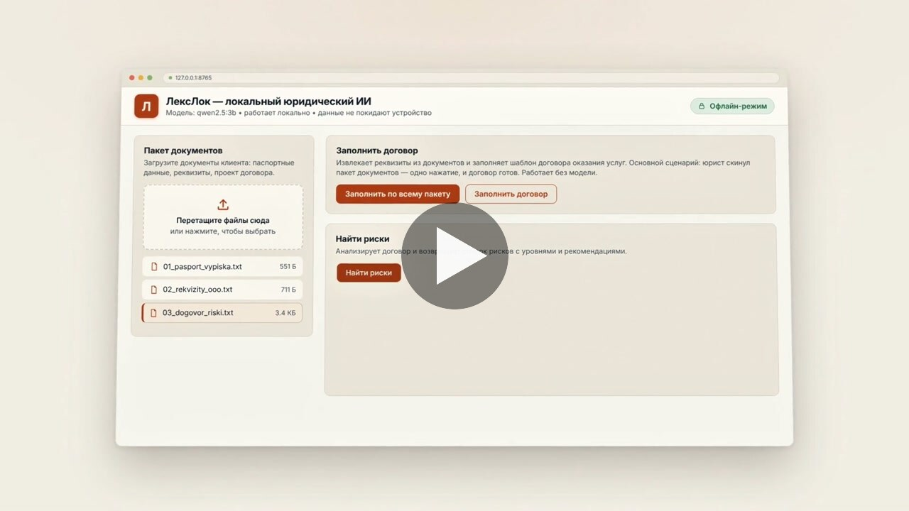
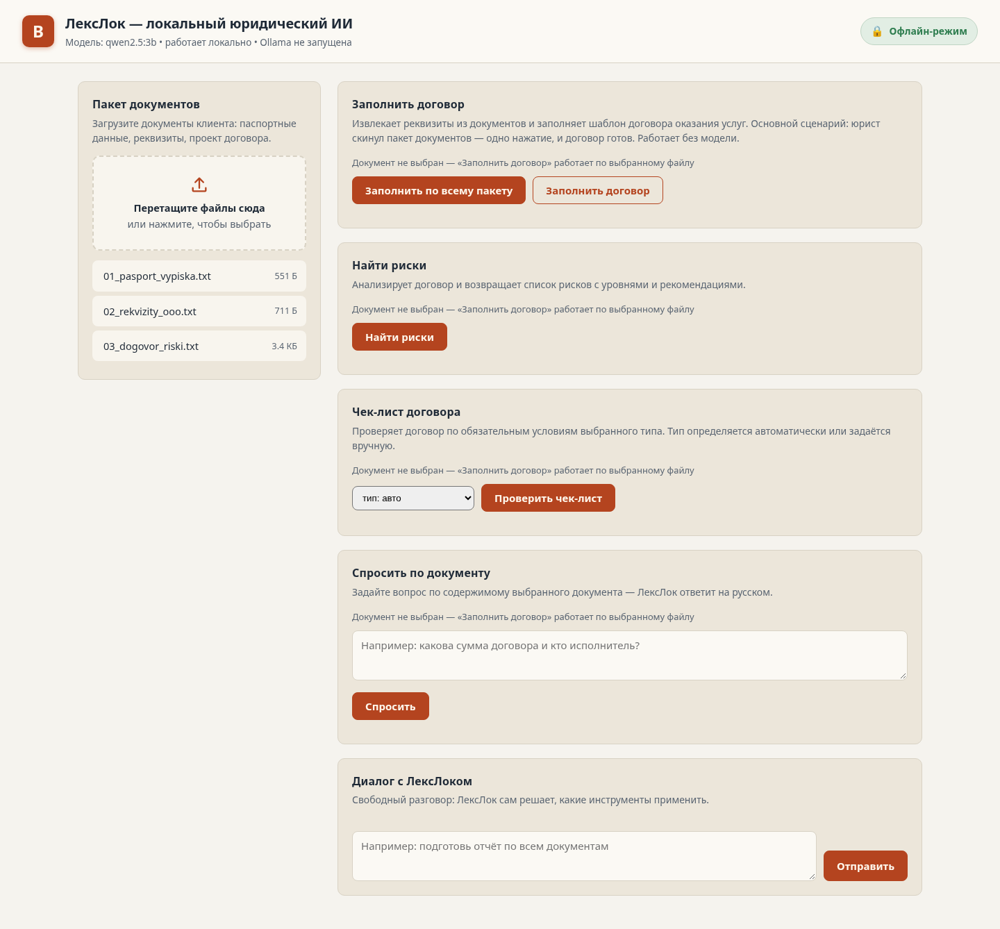

# ЛексЛок — офлайн-помощник юриста

[](docs/assets/lexlock-demo.mp4)

**▶ Видеопрезентация (20 секунд)** — нажмите на кадр, чтобы посмотреть.

## Что это — простыми словами

**ЛексЛок** — программа для юриста, которая работает целиком на вашем компьютере и
**никуда не отправляет ваши документы**. Внутри неё — искусственный интеллект (языковая
модель), который живёт прямо на вашем ноутбуке, а не в интернете.

Вы загружаете договор, паспортные данные или скан — ЛексЛок сам находит в них важное
(стороны, даты, суммы, реквизиты), заполняет договор и подсказывает, на что обратить
внимание.

Интернет нужен **только один раз** — при установке, чтобы скачать модель. Дальше можно
выключить сеть: всё продолжит работать.

Демо для акселератора 2026. Работает на обычном ноутбуке, видеокарта не нужна.



## Зачем это нужно

Юристу нельзя отправлять документы в обычные онлайн-сервисы (ChatGPT и подобные), потому
что в них — персональные данные, коммерческая тайна, а иногда и гостайна:

- **152-ФЗ «О персональных данных»** — паспорта, ИНН, адреса;
- **NDA и коммерческая тайна** — договоры, реквизиты, суммы;
- **служебная и государственная тайна** — работа вообще без внешних сервисов.

ЛексЛок решает эту задачу: документы остаются у вас, ничего не уходит наружу.

## Что умеет

1. **Заполняет договор.** Загрузили паспорт и реквизиты — получили готовый договор с
   подставленными данными. Работает мгновенно и без интернета.
2. **Читает сканы и фотографии.** Сфотографировали документ или отсканировали — ЛексЛок
   распознаёт текст и приводит его в порядок.
3. **Разбирает документ.** Говорит, что это за документ (договор, паспорт, реквизиты,
   доверенность, претензия…), кто стороны, какая дата, номер и сумма.
4. **Проверяет договор по чек-листу.** Показывает, какие обязательные условия есть, а
   каких не хватает, и на сколько процентов договор «полный».
5. **Находит подозрительные условия.** Например, автоматическую пролонгацию,
   односторонний отказ, неустойку без предела.
6. **Сверяет реквизиты.** Загрузили договор и карточку реквизитов — ЛексЛок поймает
   расхождение (например, разный ИНН в документах).
7. **Отвечает на вопросы по документу.** Спрашиваете — отвечает цитатой из текста.

## Как установить

**Рекомендуемый способ — установочный скрипт.** Одна команда в терминале. Он сам
скачает свежую версию, поставит всё необходимое (Python-окружение, Ollama, модель),
добавит «ЛексЛок» в меню программ и откроет его в браузере. Если связь оборвётся,
загрузка продолжится с места обрыва, повторный запуск ничего не ломает и не качает
заново. Готовые пакеты (раздел ниже) нужны только там, где совсем нет интернета.

Интернет нужен **один раз**, при установке: скачивается около 2 ГБ (в основном модель).
Дальше всё работает офлайн. Нужно примерно 8 ГБ ОЗУ и 5 ГБ свободного места, права
администратора на Windows не нужны.

Полная версия с описанием каждого шага, путей, журналов, обновления и удаления:
**[INSTALL.md](INSTALL.md)**.

### Windows

1. «Пуск» → наберите `PowerShell` → откройте «Windows PowerShell» (обычным щелчком,
   не от администратора).
2. Вставьте команду (правый клик по окну) и нажмите Enter:

```powershell
irm https://raw.githubusercontent.com/workihi53-max/lexlock/main/install-windows.ps1 | iex
```

Что произойдёт: скрипт создаст папку `C:\Users\<имя>\AppData\Local\LexLock`, скачает код,
поставит `uv`, Ollama (~500 МБ), Python-окружение, Tesseract для сканов (необязательно) и
модель, затем добавит ярлык в «Пуск» и откроет браузер. В окне будут шаги `[1/6]`…`[6/6]`
на русском. Всё занимает от 10 до 60 минут в зависимости от интернета. Окно закрывать нельзя.

Документы лежат в `...\LexLock\workspace`, журнал установки — `install.log` рядом.
Дальше запускайте через ярлык «ЛексЛок» в «Пуск».

Если PowerShell ругается на политику выполнения скриптов, выполните
`Set-ExecutionPolicy -Scope Process -ExecutionPolicy Bypass` и повторите команду.

### macOS

1. Откройте «Терминал» (Finder → «Программы» → «Утилиты» → «Терминал»).
2. Вставьте и нажмите Return:

```bash
curl -fsSL https://raw.githubusercontent.com/workihi53-max/lexlock/main/bootstrap.sh | bash
```

Что произойдёт: код распакуется в `~/lexlock`, поставятся `uv` и Ollama (через Homebrew,
если он есть, иначе скачается `Ollama.app`), создастся `.venv`, скачается модель, в
`~/Applications` появится «ЛексЛок.app» (виден в Launchpad), сервер запустится и откроется
браузер. Xcode, Homebrew и пароль администратора **не нужны**: чтение сканов (Tesseract)
без Homebrew тоже ставится само, в `~/.local/ocr`. Документы: `~/lexlock/workspace`.

Если macOS не открывает значок «не удалось проверить разработчика»: правый клик →
«Открыть» → «Открыть» (один раз).

### Linux

1. Откройте терминал (обычно `Ctrl+Alt+T`).
2. Вставьте и нажмите Enter:

```bash
curl -fsSL https://raw.githubusercontent.com/workihi53-max/lexlock/main/bootstrap.sh | bash
```

Что произойдёт: код распакуется в `~/lexlock`, поставятся `uv` и Ollama, создастся `.venv`,
скачается модель, в меню приложений появится «ЛексЛок», откроется браузер. Для Ollama и
чтения сканов (Tesseract: apt, dnf, pacman или zypper) **система один раз спросит пароль
`sudo`**. Скрипт заранее напишет, зачем он нужен. Это пароль, которым вы входите в
компьютер, при вводе символы не видны. Нет `sudo` или пароль не подошёл: установка не
рушится, скрипт скажет, что поставить вручную. Документы: `~/lexlock/workspace`.

### Если что-то пошло не так

- **Скрипт оборвался или была ошибка сети.** Запустите ту же команду ещё раз: скачанное
  не повторяется, загрузка продолжается.
- **Страница не открылась сама.** Откройте <http://127.0.0.1:8765> в браузере. Если порт
  8765 занят другой программой, ЛексЛок сам выберет следующий свободный (8766, 8767…) и
  скажет об этом в окне; если ЛексЛок уже запущен, просто откроет его.
- **Ничего не отвечает.** Проверьте `curl http://127.0.0.1:8765/api/health` (macOS/Linux)
  и `ollama list` (должна быть модель).
- **Слабый компьютер, тормозит.** Поставьте лёгкую модель: `ollama pull qwen2.5:1.5b`
  и укажите её в `.lexlock_model` в папке программы.
- **Windows: красная ошибка при установке.** Откройте `install.log` в папке программы и
  запустите команду заново.
- **Без доступа к GitHub или интернета нет совсем** — берите готовый пакет ниже.

Подробные разборы по каждой системе (журналы, антивирус, FUSE, Gatekeeper, обновление,
удаление) — в [INSTALL.md](INSTALL.md).

## Готовые пакеты (если нужен установщик без интернета)

Это запасной вариант. Скачиваются со страницы
[Releases](https://github.com/workihi53-max/lexlock/releases). Внутри уже Python, Ollama и
модель, поэтому при установке **ничего не качается**, но файлы большие (порядка 2 ГБ и
больше), не подписаны (система предупредит при первом запуске) и сами не обновляются.
Tesseract для сканов в пакет не входит.

| Система | Файл | Как открыть |
|---|---|---|
| Windows | `LexLock-<версия>-win-offline.zip` | распаковать **целиком** («Извлечь всё», не из окна архива), дважды щёлкнуть «Запустить ЛексЛок.bat». Если «Защитили ваш компьютер» → «Подробнее» → «Выполнить в любом случае» |
| macOS | `LexLock-<версия>-mac-arm64-offline.dmg` (Apple M1–M4) или `...-mac-x86_64-offline.dmg` (Intel) | перетащить в «Программы», первый раз правый клик → «Открыть» → «Открыть» |
| Linux | `LexLock-<версия>-linux-offline.AppImage` | `chmod +x файл`, затем `./файл`. Без FUSE: `./файл --appimage-extract-and-run` |

Документы: Windows — папка `workspace` рядом с программой; macOS и Linux — `~/LexLock/workspace`.
Журнал на macOS и Linux — `~/LexLock/lexlock.log`.

Есть и «тонкие» установщики (`LexLock-<версия>.dmg`, `...x86_64.AppImage`,
`...-win-setup.exe`): они маленькие, но при первом запуске сами докачивают Ollama и
модель, то есть интернет нужен, как и для скрипта.

**Установка мышкой без терминала на Windows:** на странице GitHub **Code → Download ZIP**,
распаковать, правый клик по `packaging\windows\install.ps1` → «Выполнить с помощью PowerShell».
Для Linux: скачать [`bootstrap.sh`](https://raw.githubusercontent.com/workihi53-max/lexlock/main/bootstrap.sh),
«Свойства» → «Разрешить выполнение файла», открыть двойным кликом.

## Как закрыть приложение

Просто закрыть вкладку браузера **недостаточно** — сервер продолжит работать в фоне.
Чтобы остановить ЛексЛок и освободить память:

- **Кнопка «■ Остановить»** в правом верхнем углу окна — самый простой способ;
- **иконка в трее** (рядом с часами) → пункт «Остановить»;
- либо перезагрузка компьютера.

## Как понять, что документы никуда не уходят

Просто выключите интернет (Wi-Fi или кабель) — ЛексЛок продолжит работать как обычно.
Это и есть главное доказательство: все данные остаются на вашем компьютере.

## Честно об ограничениях

- **Это помощник, а не замена юристу.** Программа извлекает факты и подсвечивает
  подозрительные места, но финальное решение — всегда за специалистом.
- Модель работает на обычном процессоре, поэтому распознавание сканов занимает
  несколько десятков секунд — это нормально.
- Тестовые документы в папке `samples/` — вымышленные.

---

## Для разработчиков

Проект на Python (FastAPI + Ollama). Браузер открывает локальную страницу
`http://127.0.0.1:8765`; вся обработка документов и модель — только на вашей машине,
сетевые соединения вне `127.0.0.1` блокируются принудительно.

```bash
uv venv --python 3.12 .venv
uv pip install --python .venv/bin/python -e ".[dev]"
.venv/bin/python -m pytest tests -q     # тесты не требуют Ollama
./run.sh
```

Технические детали (карта модулей, инварианты, правила) — в `AGENTS.md`, контракт
интерфейсов — в `SPEC.md`.
